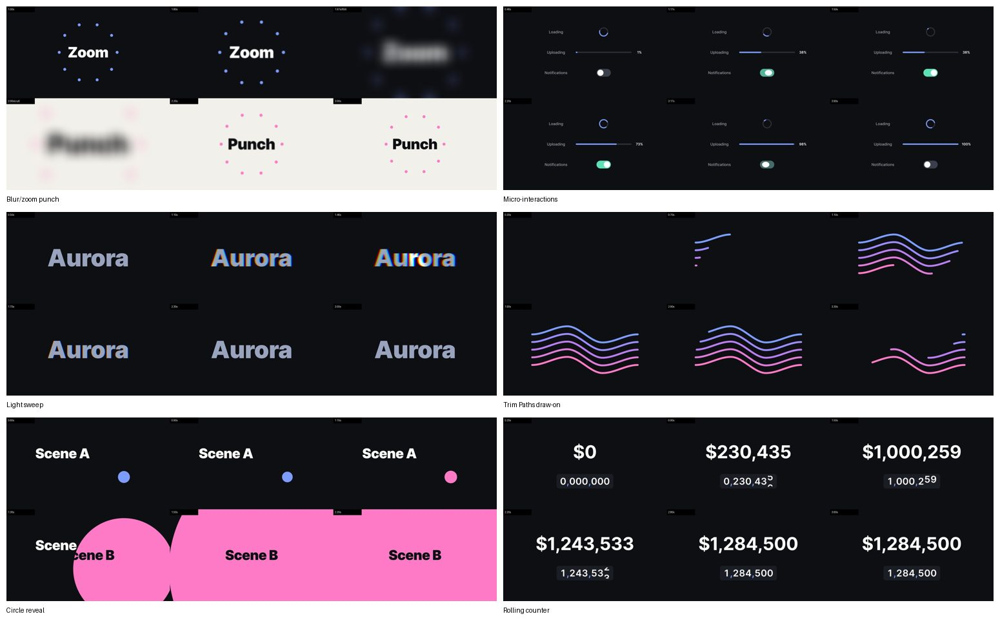

# Motion Agent

> Let Claude Code or Codex drive Adobe After Effects: read the project, build rigs, write
> keyframes with smooth Bézier easing, render frames and check the result, while you direct the
> motion in plain language.

*[中文版](README.zh-CN.md)*


Motion Agent is an After Effects panel, a local command bridge, a set of agent skills, and the
tools that keep an AI's motion work editable and verifiable. Everything stays as native AE layers
and real keyframes a designer can open in the Graph Editor: no baked renders, no black box.

**Designed and built by [Wenxin Yan](https://wenxinin.com), a Brand & Motion Designer.** Motion Agent
automates the repetitive After Effects operations. Creative direction, motion language, timing and
every final decision stay with the designer.

## What it does

| Capability | How |
|---|---|
| **Drive a live AE project** | Claude Code / Codex send JSX through a local file queue; the panel runs it inside AE. ES3-linted, one script at a time, with timeouts, so AE never hangs on a modal error. |
| **Recreate a reference from a link** | Paste a Pinterest, Behance, Vimeo or video link. The agent fetches or samples the clip, measures size, frame rate, holds, cuts, loop and palette, rebuilds it with keyframes, and checks every transition frame by frame. |
| **Smooth, editable motion** | Real keyframes with standard easing curves (Penner, Material 3, IBM Carbon) converted exactly to AE speed and influence. A keyframe audit flags linear keys, traced-sample keys and speed wobbles. |
| **Verify with numbers** | Values sampled per frame, frames captured and compared side by side with the reference, and a whole-film check that ranks shots by how far they are from it. Measured motion is compressed into a few smooth keys instead of one key per frame. |
| **Learn from every finished piece** | When a piece is approved, the agent replays the whole build and turns it into reusable recipes and rules. |
| **Stay fast** | RAM caches purged automatically during long sessions; the disk cache is cleared at 20 GB once the project is saved. |

## Where it has been used

- **[TikTok × FIFA World Cup 2026 campaign](https://wenxinin.com/work/motion/tiktok-ep-fifa-world-cup/)** (shipped):
  I designed the motion; the agent built and iterated card systems, section transitions and title
  animation in AE under my direction. See the final film in the portfolio.
- **Launch films for two AI products** (take-home design challenges, 2026): full 30-second films
  built end to end in After Effects, one of them taken from first animatic to final in an afternoon.
- **Reference recreations**: vertical app promos and UI motion rebuilt from Pinterest links.

Project files, layer structures and client assets stay private.

## Recipes



Twelve techniques built from scratch by the agent in After Effects 26.0. Each folder has the build
script, the measured key parameters and easing values, a verification report and a contact sheet.

| Text | Shapes and UI | Transitions | Effects |
|---|---|---|---|
| [Track-matte line reveal](cases/text-animation/track-matte-line-reveal/RECIPE.md) | [Trim Paths draw-on](cases/shape-animation/trim-paths-draw-on-stagger/RECIPE.md) | [Whip-pan push](cases/transitions/whip-pan-push/RECIPE.md) | [Film grain](cases/effects/film-grain-noise/RECIPE.md) |
| [Rolling number counter](cases/text-animation/number-counter-rolling-digits/RECIPE.md) | [Card list stagger](cases/ui-animation/card-list-stagger/RECIPE.md) | [Circle reveal](cases/transitions/circle-expand-reveal/RECIPE.md) | [Light sweep + chromatic shimmer](cases/effects/light-sweep-chromatic/RECIPE.md) |
| | [Throw inertia](cases/ui-animation/throw-inertia-overshoot/RECIPE.md) | [Blur/zoom punch](cases/transitions/blur-zoom-punch/RECIPE.md) | |
| | [Spinner, progress bar, toggle](cases/ui-animation/micro-interactions-trio/RECIPE.md) | [Match-cut handoff](cases/transitions/match-cut-shape-handoff/RECIPE.md) | |

**Try it in a minute:** the [checkmark pop demo](cases/projects/checkmark-pop-demo/RECIPE.md), a
footage-free project that shows exactly how the agent writes keyframes.

## Quick start (macOS)

1. Download the zips in [`dist/`](dist/): `Motion-Agent-AE-Bridge-macOS.zip` (the AE panel) and
   `Motion-Agent-Analysis-Tools-macOS.zip` (frame, audio and timing tools).
2. Unzip the bridge and double-click `install.command`, then restart After Effects.
3. In AE: **Preferences → Scripting & Expressions → Allow Scripts to Write Files and Access
   Network**, open **Window → Motion Agent.jsx** and click **Codex Desktop** or **Claude Code Desktop**.
4. In your agent, open this repository and say: *"Read skill/SKILL.md, then ping After Effects
   through the bridge."*

Full walkthrough: [ONBOARDING.md](ONBOARDING.md) · [新手指引.md](新手指引.md)

### Recreate from a link

```bash
python3 tools/fetch_reference.py "https://pin.it/..." --slug orbit
python3 tools/analyze_reference.py refs/orbit/reference.mp4
```

Then follow [`motion-replicate`](agent-skills/motion-replicate/SKILL.md). Reference videos stay in
`refs/` (git-ignored) and are credited to their creators.

## How it works

```text
Claude Code ─┐                                    ┌─ AE panel polls commands/
             ├─► ~/Library/Application Support/ ──┤  runs the JSX inside AE
Codex ───────┘   Motion Agent/runtime/            └─ writes results/ + previews/
```

## Repository

| Path | Contents |
|---|---|
| `skill/SKILL.md` | Core rules: AE safety, structure, keyframes and easing, verification, replication |
| `agent-skills/` | Workflows: best practices, create, rigs, QA, replicate, retrospective, GSAP → AE ([map](AGENT_SKILLS.md)) |
| `cases/` | 12 verified recipes and a runnable demo |
| `bridge/` | The AE panel and the CLI clients for the command queue |
| `ae_scripts/lib/easing.jsx` | Standard easing curves → AE speed and influence |
| `ae_scripts/tools/` | Tools that talk to After Effects: `run_jsx.sh`, `preflight.py`, `fx.py`, `dump_*.sh`, `audit_keyframes.jsx`, `close_comps.jsx` |
| `tools/` | Tools that don't need AE: reference fetch and analysis, browser frame sampler, contact sheets, measurement, key fitting, whole-film check, retrospective ([which folder holds what](tools/README.md)) |
| `installers/`, `dist/` | Package build scripts and ready-to-install zips |

## Principles

- **Keyframes with Bézier curves first**; expressions only where keyframes cannot do the job.
- **Measure before building**, and compare against the reference, not your intent.
- **Never guess an API**: look up effect matchNames instead of guessing.
- **The designer stays in control**: everything stays editable, and the agent's output is a
  collaborator's draft.

## License

[MIT](LICENSE).
