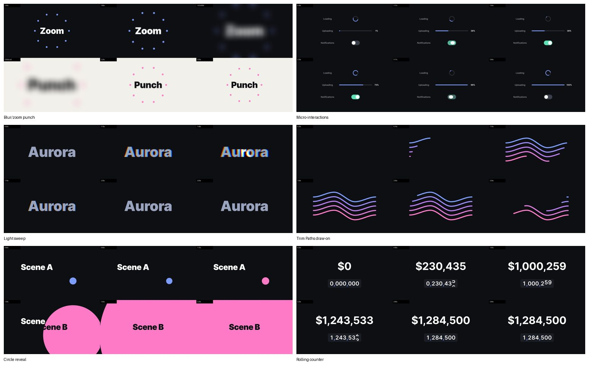

# Motion Agent

> 让 Claude Code 或 Codex 直接操作 Adobe After Effects：读工程、搭 rig、用顺滑的贝塞尔缓动写关键帧、
> 渲染截帧并自己检查结果。设计师用自然语言指挥动效。

*[English](README.md)*


Motion Agent 由四部分组成：一个 AE 面板、一条本地命令通道、一组 agent skills，以及一套让 AI 做的动效
保持可编辑、可验证的工具。所有结果都是 AE 原生图层和真实关键帧，设计师打开图表编辑器就能改。

**由品牌与动效设计师 [Wenxin Yan](https://wenxinin.com) 设计和开发。** Motion Agent 负责自动化 After Effects 里重复的操作；创意方向、动效语言、节奏和每一个最终决定都由设计师掌控。

## 能做什么

| 能力 | 怎么做 |
|---|---|
| **直接操作 AE 工程** | Claude Code / Codex 通过本地文件队列发送 JSX，面板在 AE 里执行。发送前做 ES3 预检、一次只跑一个、带超时，不会因为报错弹窗卡死 AE。 |
| **贴链接就能复刻** | 贴 Pinterest、Behance、Vimeo 或视频链接，agent 取片或在浏览器里逐帧取样，测出尺寸、帧率、停顿、剪辑点、循环和配色，用关键帧重建，并逐帧核对每个转场。 |
| **顺滑、可编辑的动画** | 真实关键帧 + 标准缓动曲线（Penner、Material 3、IBM Carbon），精确换算成 AE 的速度和影响值；关键帧体检会找出线性关键帧、逐帧描出来的密集关键帧和速度回升。 |
| **用数字验证** | 逐帧采样数值，截帧和参考片并排对比；全片粗检按镜头排出和参考差得最多的地方。测出来的运动压缩成少量平滑关键帧，不是一帧一个键。 |
| **每做完一个片子就变强** | 定稿后 agent 复盘整个制作过程，沉淀成可复用的配方和规则。 |
| **保持流畅** | 长时间操作时自动清内存缓存；磁盘缓存到 20GB 且工程已保存时自动清理。 |

## 用在哪里

- **[TikTok × FIFA 世界杯 2026 宣传项目](https://wenxinin.com/work/motion/tiktok-ep-fifa-world-cup/)**（已上线）：动效由我设计，agent 按我的方向在 AE 里搭建和迭代卡片系统、段落转场和标题动画。成片见作品集。
- **两个 AI 产品的发布片**（设计挑战，2026）：30 秒成片在 AE 里从头做完，其中一支一个下午从动态分镜做到定稿。
- **参考复刻**：从 Pinterest 链接复刻竖版 App 宣传片和 UI 动效。

工程文件、图层结构和客户素材都不公开。

## 配方



12 个在 After Effects 26.0 里从零搭建并实测验证的技法，每个目录都有构建脚本、关键参数和缓动数值、验证记录和截图拼图。

| 文字 | 图形与 UI | 转场 | 效果 |
|---|---|---|---|
| [轨道遮罩逐行显字](cases/text-animation/track-matte-line-reveal/RECIPE.md) | [Trim Paths 描边生长](cases/shape-animation/trim-paths-draw-on-stagger/RECIPE.md) | [甩镜推屏](cases/transitions/whip-pan-push/RECIPE.md) | [胶片颗粒](cases/effects/film-grain-noise/RECIPE.md) |
| [滚轮数字计数器](cases/text-animation/number-counter-rolling-digits/RECIPE.md) | [卡片列表错峰入场](cases/ui-animation/card-list-stagger/RECIPE.md) | [圆形扩张转场](cases/transitions/circle-expand-reveal/RECIPE.md) | [扫光加色散](cases/effects/light-sweep-chromatic/RECIPE.md) |
| | [甩出惯性回弹](cases/ui-animation/throw-inertia-overshoot/RECIPE.md) | [模糊变焦转场](cases/transitions/blur-zoom-punch/RECIPE.md) | |
| | [加载圈、进度条、开关](cases/ui-animation/micro-interactions-trio/RECIPE.md) | [匹配剪辑](cases/transitions/match-cut-shape-handoff/RECIPE.md) | |

**一分钟上手**：[对勾弹出演示](cases/projects/checkmark-pop-demo/RECIPE.md)，不需要任何素材，看 agent 怎么写关键帧。

## 快速开始（macOS）

1. 下载 [`dist/`](dist/) 里的两个压缩包：`Motion-Agent-AE-Bridge-macOS.zip`（AE 面板）和
   `Motion-Agent-Analysis-Tools-macOS.zip`（截帧、音频和时间分析工具）。
2. 解压面板包，双击 `install.command`，然后重启 After Effects。
3. 在 AE 里打开 **首选项 → 脚本和表达式 → 允许脚本写入文件和访问网络**，
   再打开 **窗口 → Motion Agent.jsx**，点击 **Codex Desktop** 或 **Claude Code Desktop**。
4. 在 agent 里打开本仓库，对它说：*"先读 skill/SKILL.md，然后通过 bridge ping 一下 After Effects。"*

完整步骤见 [新手指引.md](新手指引.md) · [ONBOARDING.md](ONBOARDING.md)

### 贴链接复刻

```bash
python3 tools/fetch_reference.py "https://pin.it/..." --slug orbit
python3 tools/analyze_reference.py refs/orbit/reference.mp4
```

然后按 [`motion-replicate`](agent-skills/motion-replicate/SKILL.md) 流程做。参考视频只留在本地 `refs/`（不进仓库），并注明原作者。

## 工作原理

```text
Claude Code ─┐                                    ┌─ AE 面板轮询 commands/
             ├─► ~/Library/Application Support/ ──┤  在 AE 里执行 JSX
Codex ───────┘   Motion Agent/runtime/            └─ 写入 results/ 和 previews/
```

## 目录

| 路径 | 内容 |
|---|---|
| `skill/SKILL.md` | 核心规则：AE 安全、工程结构、关键帧与缓动、验证、复刻 |
| `agent-skills/` | 工作流：最佳实践、新建、rig、QA、复刻、复盘、GSAP → AE（[路由表](AGENT_SKILLS.md)） |
| `cases/` | 12 个实测配方和一个可运行的演示 |
| `bridge/` | AE 面板和命令队列的命令行客户端 |
| `ae_scripts/lib/easing.jsx` | 标准缓动曲线 → AE 速度和影响值 |
| `ae_scripts/tools/` | 跟 AE 打交道的工具：`run_jsx.sh`、`preflight.py`、`fx.py`、`dump_*.sh`、`audit_keyframes.jsx`、`close_comps.jsx` |
| `tools/` | 不需要 AE 的工具：取片和分析、浏览器逐帧取样、截图拼图、测量、关键帧拟合、全片粗检、复盘（[分工说明](tools/README.md)） |
| `installers/`、`dist/` | 打包脚本和可直接安装的压缩包 |

## 原则

- **优先用关键帧和贝塞尔曲线**，只有关键帧做不到的地方才用表达式。
- **先测量再动手**，和参考片比，不和自己的想法比。
- **不猜 API**：效果的 matchName 一律查，不猜。
- **设计师掌控**：结果始终可编辑，agent 的产出是合作者的草稿。

## 许可

[MIT](LICENSE)。
