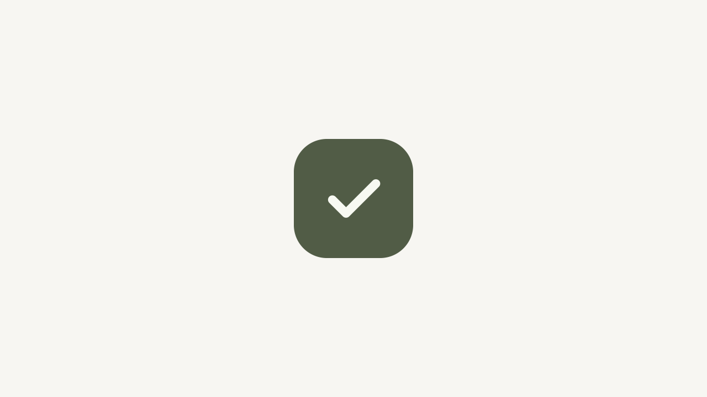

# Checkmark pop — standalone demo

**Level:** Verified · **Date:** 2026-10-28

A self-contained After Effects project that builds a checkmark "pop" with no footage,
fonts or plugins, so anyone can run it to see how Motion Agent writes keyframes.

## Run it

1. Open After Effects. Your current project is saved to `~/Desktop/Motion-Agent-Demo/Recovery/` first.
2. Run `Build_Checkmark_Demo.jsx` (File → Scripts → Run Script File, or through the bridge).
3. Optional: run `Prepare_Demo_View.jsx` to open the ×4 slow-motion comp and export a preview frame.

It creates two 1280×720, 48 fps comps: `01 - Checkmark - source timing` and `02 - Checkmark - slow motion x4`.

## Keyframes

| Property | Times (s) | Values |
|---|---|---|
| Scale | 3.25 · 3.375 · 3.458 · 3.5 | 0 → 128 → 92 → 100 % |
| Opacity | 3.25 · 3.333 · 3.708 · 3.792 | 0 → 100 → 100 → 0 |

Overshoot to 128 %, settle back through 92 %, land at 100 %: a two-bounce pop in a quarter of a second.

## Safety pattern

- Refuses to overwrite an existing demo file.
- Saves the open project to a recovery file before calling `app.newProject()`.
- Wraps the build in one undo group.

## Evidence

`evidence/demo-verification.txt`: 2 comps × 3 layers, 4 scale keys, 4 opacity keys,
0 external assets, 0 third-party effects.
